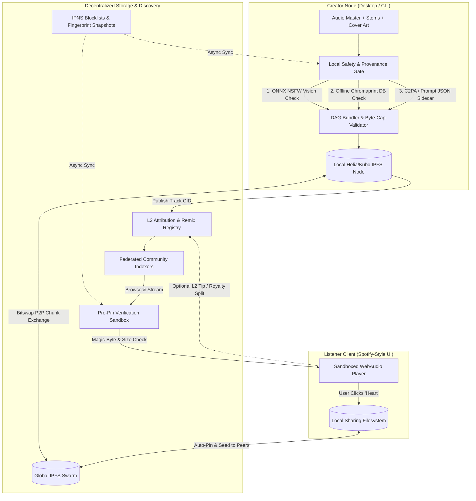

# Choiresy

**The open-source, decentralized streaming client and P2P distribution network built for the AI music revolution.**

[](https://opensource.org/licenses/MIT)
[](https://ipfs.tech/)
[](https://ethereum.org/)
[](#contributing)

Traditional streaming platforms are actively purging, shadow-banning, and demonetizing AI-assisted music—wiping out millions of tracks overnight. **Choiresy** (*choir* + *heresy*) replaces fragile corporate catalogs with an un-purgeable, community-owned music ecosystem.

Creators host their own albums directly via IPFS, and every time a listener **Hearts** a track, their local Choiresy client automatically pins the audio—along with its prompts, stems, and model metadata—into a peer-to-peer sharing filesystem that no corporate algorithm can delete or censor.

---

## ✨ Core Features

* **❤️ "Heart-to-Pin" Library:** Every track you like is automatically pulled as content-addressed chunks into your local IPFS node. As long as a single fan or creator keeps a track pinned, it stays alive globally.
* **🧬 Rich Generative Lineage:** Each track bundle (`CID`) pairs lossless/compressed audio with structured AI sidecar metadata—model weights/versions, prompt chains, seed parameters, lyrics, and optional isolated stems.
* **🌳 On-Chain Remix Trees & Micro-Royalties:** Smart contracts bind creator wallets and open-remix licenses (`CC-BY`, `Open-Split`, `Non-Commercial`) to IPFS hashes, automatically routing tips and streaming micro-payments across derivative remix lineages.
* **🛡️ Zero-Key Decentralized Verification:** Protects users and node operators without central gatekeepers using local ONNX NSFW image filtering, strict DAG byte-cap enforcement, and offline Chromaprint/AcoustID fingerprint databases distributed via IPNS.
* **🔌 1-Click Import Bridges:** CLI and browser extensions to bulk-migrate existing Suno, Udio, and local AudioCraft/Stable Audio libraries directly into your local IPFS node.

---

## 🏗️ System Architecture

Choiresy separates **permissionless P2P storage** from **modular, community-governed discovery feeds**:



### Track DAG Bundle Structure
Every published track resolves to an immutable IPFS directory `CID`:

```text
bafybeigdyrzt5sfp7udm7hu76uh7y26nf3efuylqabf3oclgtqy55fbzdi/
├── manifest.json        # Schema version, creator wallet, license, AI provenance, SHA-256 checksums
├── master.flac          # Primary audio stream (Max 150 MB, magic-byte verified)
├── cover.webp           # Album/track artwork (Max 5 MB, local ONNX NSFW verified)
└── stems/               # Optional opt-in bundle (Max 250 MB)
    ├── vocals.wav
    ├── instrumental.wav
    └── prompts.json     # Full prompt chain, negative prompts, model ID, and seed parameters
```

---

## 🚀 Quickstart

### Prerequisites
* **Node.js** `>= 20.x` & **pnpm** `>= 9.x`
* **Rust** `>= 1.78` (required if building the native Tauri desktop wrapper)
* **FFmpeg** & **Chromaprint (`fpcalc`)** installed in your system `PATH`

```bash
# macOS (Homebrew)
brew install ffmpeg chromaprint pnpm

# Ubuntu / Debian
sudo apt update && sudo apt install -y ffmpeg libchromaprint-tools
```

### 1. Clone & Install Dependencies
```bash
git clone https://github.com/choiresy/choiresy.git
cd choiresy
pnpm install
```

### 2. Download the Offline Fingerprint & Safety Snapshot
Choiresy uses local snapshots over IPNS so your node can block major-label copyrighted tracks and explicit artwork **without relying on centralized API keys**:
```bash
pnpm run sync:filters
```

### 3. Start the Local Client & Embedded IPFS Node
```bash
# Launch the web/electron dev client + local Helia IPFS daemon
pnpm run dev
```
The client UI will open at `http://localhost:5173` with your local IPFS peer active on port `4001`.

### 4. Publish Your First Track via CLI
```bash
pnpm cli publish \
  --audio ./my-tracks/neon-heresy.flac \
  --cover ./my-tracks/cover.png \
  --title "Neon Heresy" \
  --model "suno-v4" \
  --prompt "darksynth choir, analog bassline, 128 bpm" \
  --license "CC-BY-4.0"
```

---

## 🛡️ Built-In Safety & Compliance Safeguards

Because "Heart-to-Pin" writes peer data directly to listeners' disks, Choiresy enforces strict client-side and indexer-level rules before any `CID` is pinned or rendered:

| Safeguard | Mechanism |
| :--- | :--- |
| **Copyright Protection** | Runs local `fpcalc` (Chromaprint) against an offline MusicBrainz/AcoustID Bloom filter before indexing or pinning; rejects tracks exceeding a `0.85` acoustic match threshold. |
| **NSFW Artwork Blocking** | Bundles a quantized ONNX vision classifier (`NudeNet`) inside the client to block explicit cover art pre-upload and pre-render, paired with signed `pHash` blocklists. |
| **Storage Bomb Prevention** | Bitswap stream interceptors enforce hard byte ceilings (`150 MB` audio, `5 MB` artwork, `250 MB` opt-in stems) and sever peer connections immediately if streamed bytes exceed declared manifest sizes. |
| **Malware Isolation** | Validates file magic bytes (`FLAC`, `MP3`, `OGG`, `WAV`, `WEBP`, `PNG`) before disk writes and decodes all audio inside isolated WebAssembly/WebAudio workers. |

---

## 🗺️ Roadmap

- [x] Embedded Helia IPFS node with "Heart-to-Pin" auto-seeding queue
- [x] Spotify-inspired queue, playlisting, and gapless WebAudio playback
- [x] Local `fpcalc` + offline AcoustID fingerprint pre-flight checks
- [ ] **v0.2:** Suno & Udio bulk-export browser extension and CLI bridge
- [ ] **v0.3:** L2 Smart Contract deployment for automated remix royalty splits
- [ ] **v0.4:** Community "Radio Node" federation protocol & mobile companion app (iOS/Android)

---

## 🤝 Contributing

Choiresy is built by and for the open-source AI music community. Whether you are a Rust/TypeScript systems engineer, smart contract developer, UI/UX designer, or generative audio creator, we welcome your contributions!

### How to Contribute
1. **Fork the repository** and create your feature branch from `main`:
   ```bash
   git checkout -b feat/stem-visualizer
   ```
2. **Follow our architectural principles:**
   * **Zero Mandatory Centralization:** Core playback, pinning, and verification features must never require a proprietary, single-vendor API key to function.
   * **Strict Client Safety:** Any PR touching IPFS fetching, DAG parsing, or media decoding must preserve byte-cap limits and magic-byte validation tests.
3. **Run the test & lint suite** before submitting:
   ```bash
   pnpm run lint
   pnpm run test
   ```
4. **Open a Pull Request** with a clear description of the problem solved, screenshots/recordings for UI changes, and test coverage for protocol changes.

### Good First Issues
Looking for a place to start? Filter our [GitHub Issues](https://github.com/choiresy/choiresy/issues) by:
* `good first issue` — UI polish, keyboard shortcuts, and playlist export formats
* `importer-bridge` — Parsers for local ComfyUI/AudioCraft/Stable Audio metadata JSONs
* `p2p-perf` — Bitswap peer discovery and bandwidth throttling controls

---

## 📄 License

Choiresy is released under the [MIT License](LICENSE). Creators retain 100% ownership of the tracks, stems, and prompts they publish to the network.